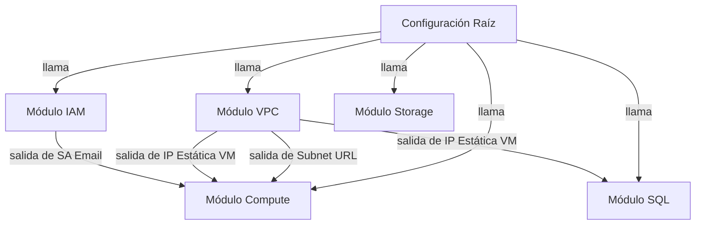

---
def-type: laboratorio
version: 1
status: succeeded
category: implementación
date: 2026-06-21
id: lab-gcp-storage-sql
contexto: google-cloud-platform
aliases:
  - gcp web lab
  - laboratorio cloud sql storage
  - gcp storage sql integration
tags:
  - gcp
  - compute-engine
  - cloud-sql
  - cloud-storage
  - lamp
---
-  **Tarea 1: <strong style ="color: 5d6d7e;">Despliega virtual machines</strong>**

	-  Ve al **Menú de navegación** > **Red VPC** > **Redes VPC**.
	-  Haz clic en **Crear red VPC**.
	    
	    -  **Nombre:** `artificial-intelligence-vpc`.
	    -  **Modo de creación de subredes:** Selecciona **Personalizado**.
	    -  **Nueva subred:**
	     
	        -  **Nombre:** `lab-subnet`.
	        -  **Región:** `us-central1`.
	        -  **Rango de direcciones IPv4:** `10.0.0.0/16`.
	-  Haz clic en **Crear**.
	-  Ve al **Menú de navegación** > **IAM y administración** > **Cuentas de servicio**.
	-  Haz clic en **+ Crear cuenta de servicio**.
	
	    -  **Nombre:** `bloghost-sa`.
	    -  Haz clic en **Crear y continuar** y luego en **Listo**.
	-  En la misma sección de **Red VPC**, ve a la pestaña **Firewall**.
	-  Haz clic en **Crear regla de firewall**.
	
	    -  **Nombre:** `allow-ssh-http`.
	    -  **Red:** `artificial-intelligence-vpc`.
	    -  **Dirección de entrada:** Entrada.
	    -  **Destinos:** Instancias de red objetivo.
	    -  **Etiquetas de destino:** `web-server`.
	    -  **Rangos de IP de origen:** `0.0.0.0/0`.
	    -  **Protocolos y puertos:** Selecciona **TCP** y marca **22** y **80**.
	-  Haz clic en **Crear**.
	-  Ve al **Menú de navegación** > **Compute Engine** > **Instancias de VM**.
	-  Haz clic en **Crear instancia**.
	
	    -  **Nombre:** `bloghost`.
	    -  **Región:** `us-central1` | **Zona:** `us-central1-a`.
	    -  **Redes:** Expande esta sección. En **Interfaces de red**, selecciona la red `artificial-intelligence-vpc` y la subred `lab-subnet`.
	    -  **Identidad y acceso a API:** En **Cuenta de servicio**, selecciona la que creamos (`bloghost-sa`).
	    -  **Etiquetas de red:** Escribe `web-server` (esto activa la regla de firewall anterior).
	    -  **Automatización:** En el campo de **Secuencia de comandos de inicio**, pega tu código:
	
			apt-get update
			apt-get install apache2 php php-mysql -y
			service apache2 restart
	-  Haz clic en **Crear**.
	
	![[infra-for-default.mp4]]
-  **Tarea 2: <strong style ="color: 5d6d7e;">Crea un bucket en Cloud Storage</strong>**

	-  **Crear el bucket:**
	    
	    -  Ve al **Menú de navegación** > **Cloud Storage** > **Buckets**.
	    -  Haz clic en **+ Crear**.
	    -  **Nombre:** Usa el ID de tu proyecto (es globalmente único). Haz clic en **Continuar**.
	    -  **Ubicación:** Selecciona el tipo (Multirregión) y elige `US`, `EU` o `ASIA` según tus necesidades. Haz clic en **Continuar**
	    -  **Clase de almacenamiento:** Selecciona **Standard**. Haz clic en **Continuar**.
	    -  **Control de acceso:** Selecciona **Fine-grained** (esto es crucial para que luego podamos gestionar permisos a nivel de objeto/ACL). 
	    -  Haz clic en **Continuar**.
	    -  Haz clic en **Crear**.
	-  **Subir la imagen:**
	
	    -  Haz clic en el nombre del bucket que acabas de crear.
	    -  Haz clic en **Subir archivos** y selecciona la imagen `my-excellent-blog.png` desde tu equipo local. _(Nota: Si no la tienes, primero descárgala a tu equipo local desde la URL pública `gs://cloud-training/gcpfci/my-excellent-blog.png` usando un navegador)._
	-  **Hacer pública la imagen:**
	
	    -  Una vez subida, verás el archivo en la lista de objetos del bucket.
	    -  Haz clic en los **tres puntos verticales** (menú de acciones) a la derecha del archivo.
	    -  Selecciona **Editar permisos**.
	    -  Haz clic en **+ Agregar entrada**.
	    -  **Entidad:** Selecciona **Público**.
	    -  **Nombre:** Escribe `allUsers`.
	    -  **Acceso:** Selecciona **Lector** (esto equivale al `:R` de `gsutil`).
	    -  Haz clic en **Guardar**.
	        
	
	**Explicación técnica:** Al seleccionar **Fine-grained** en el control de acceso, permites que los objetos individuales dentro del bucket tengan sus propias políticas, permitiéndonos configurar el acceso `allUsers:R` sin exponer todo el bucket. Este es un punto de control de seguridad fundamental para gestionar recursos estáticos públicos.
-  **Tarea 3: <strong style ="color: 5d6d7e;">Crea la instancia de Cloud SQL</strong>**

	-  **Inicio del servicio**: Ve a **SQL** en el menú de navegación y haz clic en **Crear instancia**. Selecciona **MySQL**.
	-  **Edición y motor**: En **Edición de Cloud SQL**, elige **Enterprise** y selecciona **Zona de pruebas** en el menú desplegable.
	-  **Configuración de instancia**:
	    
	    -  **ID de instancia**: `blog-db`.
	    -  **Contraseña**: Establece una contraseña para el usuario root y anótala.
	    -  **Región**: Selecciona la misma región de tu VM.
	    -  **Disponibilidad zonal**: Selecciona **Zona única**. Haz clic en **Especificar zonas** y elige la **Zona principal** correspondiente a tu VM para minimizar la latencia.
	    -  Haz clic en **Crear instancia**.
	        
	-  **Recolección de datos**: En la página de detalles de `blog-db`, bajo la sección **Conectarse a esta instancia**, copia la dirección IP pública y guárdala.
	-  **Gestión de usuarios**:
	    
	    -  En el panel izquierdo, haz clic en **Usuarios** y luego en **Agregar cuenta de usuario**.
	    -  **Nombre de usuario**: `blogdbuser`.
	    -  **Contraseña**: Define una contraseña (anótala) y haz clic en **Agregar**.
	-  **Configuración de seguridad de red**:
	    
	    -  En el panel izquierdo, haz clic en **Conexiones** y selecciona la pestaña **Herramientas de redes**.
	    -  Haz clic en **Agregar una red**.
	    -  Si se solicita, elige **IP pública**.
	    -  **Nombre**: `web front end`.
	    -  **Red**: Ingresa la IP externa de tu VM `bloghost` seguida de `/32` (ej. `35.192.208.2/32`).
	-  **Validación**: Haz clic en **Listo** y luego en **Guardar**. Si visualizas el mensaje "Hay otra operación en curso", es imperativo esperar hasta que aparezca la marca de verificación verde junto a `blog-db` para confirmar que la regla de firewall ha sido aplicada correctamente.
	    
	
	**Explicación técnica:** La sección de **Redes autorizadas** funciona como un firewall granular. Al utilizar la máscara `/32`, restringes el acceso exclusivamente a la dirección IP específica de tu servidor web (`bloghost`), blindando la base de datos contra conexiones no autorizadas desde el resto de internet.
-  **Tarea 4**: <strong style ="color: 5d6d7e;">Configurar aplicación en instancia para usar Cloud SQL</strong>

	-  **Acceso al servidor**:
	    
	    -  Ve a **Compute Engine** > **Instancias de VM**.
	    -  Haz clic en el botón **SSH** en la fila de tu instancia `bloghost`.
	-  **Creación del script de conexión**:
	    
	    -  En la terminal SSH, navega a la raíz del documento: `cd /var/www/html`.
	    -  Crea el archivo con el editor: `sudo nano index.php`.
	    -  Pega el código PHP proporcionado (manteniendo los marcadores `CLOUDSQLIP` y `DBPASSWORD` tal cual).
	    -  Guarda los cambios con `Ctrl + O` seguido de `Intro` y sal del editor con `Ctrl + X`.
	    -  Reinicia el servidor: `sudo service apache2 restart`.
	-  **Validación de error inicial**:
	    
	    -  Abre la IP externa de tu VM en el navegador: `http://[IP_EXTERNA_BLOGHOST]/index.php`.
	    -  **Resultado esperado**: Debes ver el mensaje `Database connection failed`. Esto confirma que el servidor web tiene alcance de red hacia la base de datos, pero el acceso está siendo denegado porque aún no se han configurado las credenciales correctas.
	-  **Configuración de credenciales de Cloud SQL**:
	    
	    -  Regresa a la sesión SSH de `bloghost` y abre el archivo nuevamente: `sudo nano index.php`.
	    -  Localiza las variables y realiza los reemplazos:
	        
	        -  Sustituye `CLOUDSQLIP` por la **IP pública** de la instancia `blog-db` que anotaste en la Tarea 3.
	        -  Sustituye `DBPASSWORD` por la **contraseña** que definiste para el usuario `blogdbuser` en la Tarea 3.
	    -  Guarda los cambios (`Ctrl + O`, `Intro`) y sal (`Ctrl + X`).
	    -  Reinicia el servidor: `sudo service apache2 restart`.
	-  **Verificación final**:
	
	    -  Refresca la pestaña del navegador.
	    -  **Resultado esperado**: La página debe mostrar ahora `Connected successfully`. Esto valida que el script PHP ha logrado autenticarse exitosamente contra Cloud SQL mediante el túnel de red autorizado.
	
	**Explicación técnica:** La transición de un error de conexión a una conexión exitosa es la prueba definitiva de que la política de firewall en Cloud SQL (Tarea 3) está correctamente aplicada. Al proporcionar las credenciales correctas, el motor PHP dentro de la instancia utiliza los protocolos de autenticación de MySQL para validar la identidad, permitiendo que la aplicación interactúe con la base de datos.
-  **Tarea 5**: <strong style ="color: 5d6d7e;">Configura aplicación en instancia para utilizar un objeto de Cloud Storage</strong>

	-  **Obtención del Vínculo Público**:
	    
	    -  Ve a **Cloud Storage** > **Buckets** y entra en el bucket que lleva el nombre de tu proyecto.
	    -  Localiza el objeto `my-excellent-blog.png`.
	    -  Copia la **URL pública** que aparece en la columna de acceso público (o junto a "Vínculo público"). Si no visualizas el icono, refresca la página o verifica en Cloud Shell que la regla `gsutil acl ch -u allUsers:R` se aplicó correctamente.
	-  **Edición del frontend**:
	    
	    -  Regresa a la sesión **SSH** de `bloghost` y navega a `/var/www/html`.
	    -  Abre el archivo con `sudo nano index.php`.
	    -  Sitúa el cursor justo debajo del elemento `<h1>` y pega la siguiente estructura HTML utilizando la URL que copiaste: ``
	-  **Aplicación de cambios**:
	    
	    -  Guarda el archivo con `Ctrl + O` seguido de `Intro`.
	    -  Sal del editor con `Ctrl + X`.
	    -  Reinicia el servicio web: `sudo service apache2 restart`.
	-  **Validación final**:
	    
	    -  Refresca la pestaña del navegador donde tienes abierta la IP externa de `bloghost`. Deberías ver tu blog con el mensaje de conexión exitosa a la base de datos y la imagen del banner cargada correctamente.
	        
	**Explicación técnica**: Al integrar la URL pública de Cloud Storage mediante la etiqueta ``, el navegador del usuario final recupera la imagen directamente desde el servicio de almacenamiento. Esto desacopla el tráfico de objetos estáticos de tu instancia de computación, optimizando la latencia y reduciendo la carga sobre `bloghost`, permitiendo que la VM se enfoque exclusivamente en procesar la lógica dinámica de la aplicación.

![[barra.gif]]
###### **Diagrama de arquitectura**

Los recursos se organizan en cinco módulos desacoplados:

> [!NOTE]
> **Resolución de la dependencia cíclica:**
> 
> Al automatizar la configuración del archivo `index.php` con las credenciales de base de datos directamente en el inicio de la Virtual Machine, se introduce una dependencia lógica hacia el módulo SQL. Dado que el módulo SQL también requiere la dirección IP de la Virtual Machine para su lista de redes autorizadas, existía una dependencia cíclica.
> 
> Para solucionar esto de manera elegante, el módulo VPC reserva una IP externa estática (`google_compute_address`). Esta IP es conocida por el planificador de Terraform *antes* de crear la VM y la base de datos, lo que permite romper el ciclo.

![[barra.gif]]

**Estimación de costos (us-central1)**

Asumiendo que la VM y la base de datos se ejecutan durante el tiempo máximo de **30 minutos** antes del apagado/eliminación:

| Recurso | Modelo de Precios | Tarifa Unitaria | Costo Est. (30 min) |
| :--- | :--- | :--- | :--- |
| **VM e2-micro** | Instancia Spot | ~$0.0042 / hr | **$0.0021** |
| **Disco de Arranque HDD Estándar (10GB)** | Almacenamiento | ~$0.04 / GB / mes | **$0.00027** |
| **IP Estática de VM** | Gratuita (mientras esté en uso) | $0.00 | **$0.0000** |
| **VPC & Cuenta de Servicio** | Gratuito | $0.00 | **$0.0000** |
| **Bucket de Cloud Storage (~50KB)** | Almacenamiento Estándar | ~$0.02 / GB / mes | **$0.0000** |
| **Instancia Cloud SQL (db-f1-micro)** | Enterprise (Zona de Pruebas) | ~$0.015 / hr | **$0.0075** |
| **Costo Total Estimado** | - | - | **~$0.00987 USD** (menos de 1 centavo de dólar) |

-  **Archivos**

	-  **Raíz**: 
	
		-  [[checks.tf]]
		-  [[sebastian/assets/laboratorium/gcp-introduction-cloud-storage-and-sql/terraform/main.tf]]
		-  [[sebastian/assets/laboratorium/gcp-introduction-cloud-storage-and-sql/terraform/outputs.tf]]
		-  [[providers.tf]]
		-  [[sebastian/assets/laboratorium/gcp-introduction-cloud-storage-and-sql/terraform/terraform.tfvars]]
		- [[sebastian/assets/laboratorium/gcp-introduction-cloud-storage-and-sql/terraform/variables.tf]]
	-  **Essets:**
	
		- [[my-excellent-blog.png]]
		- [[check_resources.py]]
	-  **Modules:**
	
		- [[sebastian/assets/laboratorium/gcp-introduction-cloud-storage-and-sql/terraform/modules/compute/main.tf]]
		- [[sebastian/assets/laboratorium/gcp-introduction-cloud-storage-and-sql/terraform/modules/compute/outputs.tf]]
		- [[sebastian/assets/laboratorium/gcp-introduction-cloud-storage-and-sql/terraform/modules/compute/variables.tf]]
		
		- [[sebastian/assets/laboratorium/gcp-introduction-cloud-storage-and-sql/terraform/modules/iam/main.tf]]
		- [[sebastian/assets/laboratorium/gcp-introduction-cloud-storage-and-sql/terraform/modules/iam/outputs.tf]]
		- [[sebastian/assets/laboratorium/gcp-introduction-cloud-storage-and-sql/terraform/modules/iam/variables.tf]]
		
		- [[sebastian/assets/laboratorium/gcp-introduction-cloud-storage-and-sql/terraform/modules/sql/main.tf]]
		- [[sebastian/assets/laboratorium/gcp-introduction-cloud-storage-and-sql/terraform/modules/sql/outputs.tf]]
		- [[sebastian/assets/laboratorium/gcp-introduction-cloud-storage-and-sql/terraform/modules/sql/variables.tf]]
		
		- [[sebastian/assets/laboratorium/gcp-introduction-cloud-storage-and-sql/terraform/modules/storage/main.tf]]
		- [[sebastian/assets/laboratorium/gcp-introduction-cloud-storage-and-sql/terraform/modules/storage/outputs.tf]]
		- [[sebastian/assets/laboratorium/gcp-introduction-cloud-storage-and-sql/terraform/modules/storage/variables.tf]]
		
		- [[sebastian/assets/laboratorium/gcp-introduction-cloud-storage-and-sql/terraform/modules/vpc/main.tf]]
		- [[sebastian/assets/laboratorium/gcp-introduction-cloud-storage-and-sql/terraform/modules/vpc/outputs.tf]]
		- [[sebastian/assets/laboratorium/gcp-introduction-cloud-storage-and-sql/terraform/modules/vpc/variables.tf]]
