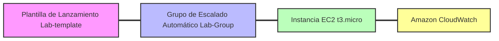

![[introduction-to-amazon-ec2-auto-scaling.webp]]

*  Crear una plantilla de lanzamiento.
*  Crear un grupo de escalado automático.
*  Consultar los resultados del lanzamiento de Auto Scaling.
*  Probar la infraestructura de Auto Scaling.

-  **Tarea 1:  <strong style ="color:5d6d7e;">Crear una plantilla de lanzamiento</strong>**

	*  Se debe crear una plantilla de lanzamiento para incluir los parámetros necesarios con el fin de lanzar una instancia de EC2, como el ID de la imagen de máquina de Amazon (AMI) y un tipo de instancia.
	*  En la consola de administración de AWS, se busca y selecciona EC2.
	*  En el panel de navegación izquierdo, dentro de instancias, se eligen las plantillas de lanzamiento.
	*  Se selecciona crear plantilla de lanzamiento.
	*  En el nombre de la plantilla se introduce `Lab-template` y en la descripción de la versión se introduce `version 1`.
	*  En la sección de imágenes de aplicaciones y sistemas operativos, dentro de inicio rápido, se selecciona Amazon Linux.
	*  En la sección de tipo de instancia, se selecciona `t3.micro`.
	*  En la configuración de redes, para los grupos de seguridad, se selecciona `MySecurityGroup`.
	*  Se selecciona crear plantilla de lanzamiento y luego ver plantillas de lanzamiento.
-  **Tarea 2: <strong style ="color:5d6d7e;">Crear un grupo de escalado automático</strong>**

	*  Un grupo de escalado automático contiene una colección de instancias de EC2 que comparten características similares y se tratan como una agrupación lógica.
	*  En el panel de navegación izquierdo, en Auto Scaling, se eligen los grupos de escalado automático.
	*  Se selecciona crear grupo de Auto Scaling.
	*  En el nombre del grupo de Auto Scaling se introduce `Lab-Group` y se selecciona la plantilla de lanzamiento `Lab-template`.
	*  En la VPC se elige `Lab VPC` y para las subredes se seleccionan ambas subredes.
	*  En el periodo de gracia de comprobación de estado se introduce 60.
	*  En la configuración del tamaño y la escala del grupo, se ingresa 1 para la capacidad mínima deseada y 2 para la capacidad máxima deseada.
	*  Para la supervisión, se selecciona habilitar la recopilación de métricas de grupo en CloudWatch.
	*  Se avanza por las páginas siguientes y se selecciona crear grupo de Auto Scaling.
-  **Tarea 3: <strong style ="color:5d6d7e;">Verificar el grupo de escalado automático</strong>**

	*  En la página de grupos de escalado automático, se selecciona el grupo `Lab-Group`.
	*  En la pestaña de detalles, se examinan los detalles del grupo.
	*  En la pestaña de actividad, se puede observar el estado actual y el historial del ciclo de vida de las instancias.
	*  En la pestaña de administración de instancias, se puede verificar que la instancia de EC2 se encuentra en el estado del ciclo de vida en servicio.
	*  En la pestaña de supervisión, se puede ver la información relacionada con la supervisión del grupo de escalado automático.
-  **Tarea 4: <strong style ="color:5d6d7e;">Realizar pruebas de escalado automático</strong>**

	*  La capacidad mínima del grupo de escalado automático es de 1 instancia, por lo que al terminar la instancia en ejecución, Auto Scaling debe lanzar una nueva instancia para reemplazarla.
	*  En la pestaña de administración de instancias, se elige el ID de instancia.
	*  En el menú de estado de la instancia, se elige terminar instancia.
	*  En el cuadro de diálogo, se confirma la terminación.
	*  Al revisar nuevamente el grupo de escalado automático y la pestaña de administración de instancias o actividad, se observa que aparece una nueva instancia con el estado pendiente o en servicio para reemplazar la anterior.

**Explicaciones técnicas**

*  Auto Scaling permite garantizar que se cuenta con la cantidad correcta de instancias de Amazon EC2 disponibles para manejar la carga de trabajo.
*  El servicio solo lanza nuevas instancias o termina las instancias existentes, sin detener ni iniciar instancias.
*  No hay cargos adicionales con Auto Scaling, pagando únicamente por las instancias de Amazon EC2 que se inician.

**Preguntas de profundización**

*  ¿Qué ventajas ofrece establecer un periodo de gracia de comprobación de estado de 60 segundos en lugar de los 300 segundos predeterminados en un entorno de pruebas?