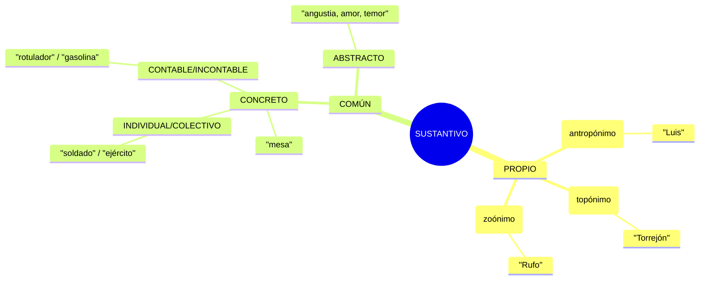

---
tags:
  - lengua
  - gramatica
  - adjetivo
  - calificativo
  - 3ESO
source: pizarra
fecha: 2026-11-10
profesora: lengua castellana
---
###### **Esquema para el análisis morfológico de sustantivos**

1. **El análisis morfológico del sustantivo**

	El sustantivo (o nombre) es la palabra que sirve para nombrar a la realidad (personas, animales, objetos, ideas, sentimientos). en tu esquema se divide en dos grandes ramas:
	
	*  **Propios:** Nombran a un ser o lugar de forma individual para distinguirlo de los demás.
	
		*  **Antropónimo:** Nombres de persona (ej. *Luis*). la raíz griega *antro* significa persona.
		*  **Topónimo:** Nombres de lugar (ej. *Torrejón*). la raíz *topo* significa lugar.
		*  **Zoónimo:** Nombres propios de animales (ej. *Rufo*). la raíz *zoó* significa animal.
	*  **Comunes:** Nombran a cualquier ser u objeto de una misma clase de forma general.
	  
		*  **Concreto vs. abstracto:** Los concretos nombran seres reales que podemos percibir con los sentidos o tocar (ej. *mesa*, *rotulador*). los abstractos nombran conceptos inmateriales que no se pueden tocar, como sentimientos o ideas (ej. *angustia*, *amor*, *temor*).
		*  **individual vs. colectivo:**
		
			*  **individual**: En singular nombra a un solo elemento (ej. *soldado*).
			*  **colectivo:** Aunque esté escrito en **singular**, nombra en su significado a un conjunto de elementos de la misma clase (ej. *ejército*, que es un conjunto de soldados). **cuidado:** un error común es confundir el plural (*soldados*) con el colectivo (*ejército*).
		*  **Contable vs. incontable:** los contables se pueden numerar (un rotulador, dos rotuladores). los incontables nombran sustancias o masas que no se pueden contar por unidades independientes, sino que se miden o pesan (ej. *gasolina*, *agua*, *arena*).
	
	**¿Cómo se analiza un sustantivo común?**
	
	Cuando analizas morfológicamente un sustantivo común, **no escoges solo uno**, sino que debes indicar todas sus categorías cruzadas:
	
	*  Género (masculino / femenino)
	*  Número (singular / plural)
	*  Si es común, y luego vas completando: **concreto o abstracto**, **contable o incontable**, e **individual o colectivo**. (por ejemplo, la palabra *soldado* es: sustantivo común, concreto, contable e individual).
2. **Duda sobre los determinantes y los nombres propios**

	"**Si de la palabra** 'esta pizarra es una pasada' ¿Cuál es el sustantivo? ¿Estaría mal poner un determinante antes de un sustantivo? No llevan determinantes los nombres".
	
	*  **El sustantivo** en esa frase es **pizarra** (y también *pasada*).
	*  **La regla de los determinantes y los nombres:**
	*  Los **nombres propios** de persona (como *María* o *Carlos*) **no** suelen llevar determinantes delante (*"el Juan"* es un vulgarismo o uso coloquial incorrecto en la norma culta del español).
	*  Sin embargo, los **sustantivos comunes** (como *pizarra*, *mesa* o *coche*) **sí** llevan determinantes de manera natural y correcta (por ejemplo, *"esta* pizarra", donde *esta* es un determinante demostrativo).
3. **Morfología frente a sintaxis**

	La gramática se divide en estas dos grandes áreas:
	
	*  **Morfología:** estudia la categoría de las palabras (si es un sustantivo, un verbo, un adjetivo, etc.) y también analiza su **estructura interna** (cómo se componen por dentro: lexemas o raíces, prefijos y sufijos).
	*  **Sintaxis:** estudia cómo se agrupan las palabras y **qué función cumplen** dentro de una oración (por ejemplo, qué parte funciona como sujeto, como predicado, o como grupo nominal - SN).
4. **Pautas clave para elaborar un buen resumen**

	Cuando te piden resumir un texto (como el fragmento que tienes sobre los anticuarios en el rastro de Madrid en 2017), debes seguir estas reglas estrictas:
	
	*  **La introducción informativa (las 4 'W'):** la persona que lee tu resumen no conoce el texto original, por lo que las primeras líneas deben responder de inmediato a:
	  
		*  **¿Cuándo?** (ej. en el año 2017)
		*  **¿Dónde?** (ej. en el rastro de Madrid)
		*  **¿Quiénes?** (ej. dos anticuarios y los herederos de Ramón y Cajal)
		*  **¿Qué pasó?** (ej. adquirieron y descubrieron una historia de abandono y expolios en el palacete familiar).
	*  **Evita los verbos de lengua:** no utilices muletillas del tipo *"el texto dice que..."*, *"el autor comenta que..."*, *"nos explica que..."*. ve directo a los hechos narrados.
	*  **Síntesis y orden:** cuenta con tus propias palabras la evolución de la historia de forma breve, eliminando detalles secundarios o adjetivos de relleno.

###### El adjetivo calificativo y análisis morfológico avanzado

**El plano del significado y sus tipos**

En el plano del significado, la función del adjetivo se divide en dos grandes comportamientos lógicos y discursivos:
 
-  **Adjetivos especificativos**: delimitan y reducen el universo de referencia del sustantivo. Su presencia es indispensable para identificar a qué entidad nos referimos dentro de un conjunto. Al decir los coches rojos, el adjetivo rojos excluye a todos los vehículos que no posean ese color.
-  **Adjetivos explicativos o epítetos**: no restringen el significado del sustantivo, sino que destacan una cualidad inherente, estética o evocadora que ya está implícita o que posee un valor estilístico. Ejemplos clásicos incluyen la blanca nieve o el fuego abrasador. Su omisión no altera la identificación del objeto, pero modifica el tono expresivo del texto.

**La posición sintáctica como motor de cambio semántico**

En español, la colocación del adjetivo respecto al núcleo nominal (el sustantivo) no es neutral. El cambio de orden (anteposición frente a posposición) altera con frecuencia el valor semántico del sintagma, desplazando el adjetivo de un plano denotativo a uno valorativo, metafórico o restrictivo.

- **Gran**: antepuesto (un gran hombre) adquiere un valor metafórico de grandeza moral, ilustre o eminente. Pospuesto (un hombre grande) describe una dimensión física o corpórea real.
- **Viejo**: antepuesto (un viejo amigo) indica una relación de larga data o afecto consolidado en el tiempo. Pospuesto (un amigo viejo) señala la edad avanzada cronológica de la persona.
- **Pobre**: antepuesto (un pobre hombre) expresa compasión, desdicha o insignificancia existencial. Pospuesto (un hombre pobre) denota una carencia strictly económica o material.

**Funciones sintácticas avanzadas**

El adjetivo calificativo desempeña tres funciones sintácticas primordiales dentro de la oración simple y compuesta:

1. **Adyacente o modificador directo**: se integra dentro del sintagma nominal, concertando en género y número con el núcleo (el libro fascinante).
2. **Atributo**: aparece vinculado al sujeto a través de verbos copulativos (ser, estar, parecer). En este caso, el adjetivo predica una cualidad del sujeto que es esencial para la coherencia semántica de la proposición (la teoría parecía sólida).
3. **Complemento predicativo** (CPred): funciona como un elemento bisagra que concuerda morfológicamente con el sujeto o con el complemento directo, al tiempo que modifica la acción verbal. Por ejemplo, en los alumnos salieron agotados del examen, el adjetivo agotados concuerda en masculino plural con el sujeto (alumnos), pero su presencia está exigida simultáneamente por la dinámica del verbo principal y el contexto situacional.
    
**Superlativos cultos y morfología irregular**

Si bien el grado superlativo se construye frecuentemente de manera analítica mediante el adverbio muy o la adición del sufijo sintético -ísimo / -ísima, la lengua culta conserva formas etimológicas derivadas del latín que sustituyen al adjetivo base o emplean terminaciones cultas particulares en -érrimo / -érrima.

|Adjetivo base|Superlativo culto|Observaciones morfológicas|
|---|---|---|
|Pobre|Paupérrimo|Derivación culta patrimonial directa del latín pauperrima|
|Célebre|Celebérrimo|Conservación de la raíz latina con sufijo superlativo culto|
|Libre|Libérrimo|Mantiene la e tónica original latina|
|Mísero|Misérrimo|Aplicado a situaciones o condiciones de extrema indigencia|
|Acrérrimo / acérrimo|Acérrimo|Derivado de acre (áspero o tenaz enérgicamente)|

Asimismo, la intensificación puede lograrse mediante prefijos cultos de valor elativo como super-, archi-, recontra- o extra-, los cuales operan de manera análoga al superlativo absoluto sin requerir flexión sufijal.

**Ejercicios prácticos de análisis morfológico**

Identificación y análisis morfológico de adjetivos calificativos en oraciones reales:

-  A) La cochera estaba más sucia que el trastero.
    
	-  Adjetivo analizado: sucia
	-  Análisis morfológico: adjetivo calificativo, dos terminaciones, grado comparativo de superioridad, femenino, singular.    
-  B) María parecía menos concentrada que su compañera.
    
	-  Adjetivo analizado: concentrada
	-  Análisis morfológico: adjetivo calificativo, dos terminaciones, grado comparativo de inferioridad, femenino, singular.    
-  C) Estoy muy atento durante las clases.
    
	-  Adjetivo analizado: atento
	-  Análisis morfológico: adjetivo calificativo, dos terminaciones, grado superlativo absoluto, masculino, singular.    
-  D) Ese es el menos amable de todos.
    
	-  Adjetivo analizado: amable
	-  Análisis morfológico: adjetivo calificativo, una terminación, grado superlativo relativo, masculino, singular.    
-  E) Ana está tan ilusionada como su hermano.
    
	-  Adjetivo analizado: ilusionada
	-  Análisis morfológico: adjetivo calificativo, dos terminaciones, grado comparativo de igualdad, femenino, singular.    
-  F) El pequeño Nico está resfriadísimo.
    
	-  Adjetivo analizado: resfriadísimo
	-  Análisis morfológico: adjetivo calificativo, dos terminaciones, grado superlativo absoluto, masculino, singular.    
-  G) Ese cable es el más grueso del manojo.
    
	-  Adjetivo analizado: grueso
	-  Análisis morfológico: adjetivo calificativo, dos terminaciones, grado superlativo relativo, masculino, singular.

**Tipología textual y formas de elocución**

La tipología textual clasifica los textos según su intención comunicativa y sus características estructurales.

- **Narrativo**: Un narrador cuenta unos hechos que les suceden a unos personajes en un determinado tiempo y espacio.
- **Argumentativo**: Plantea una opinión o tesis (idea defendida) y la defiende mediante argumentos o razones orientadas a convencer al receptor.
- **Descriptivo**: Funciona como un «pintar con palabras», especificando cómo es un objeto, persona, lugar o concepto.
- **Instructivo**: Proporciona pautas, normas o pasos a seguir (por ejemplo, el folleto de montaje de un mueble o el prospecto de un medicamento).
- **Expositivo**: Presenta información de manera objetiva (por ejemplo, la biografía de un autor en una enciclopedia virtual o un artículo en una revista que define el cambio climático).
    
**Objetividad y subjetividad en los textos**

- **Objetividad**: Transmite información de forma neutra y directa, sin incluir opiniones personales del autor.
- **Subjetividad**: Aporta información bajo un punto de vista particular, incorporando valoraciones y opiniones personales.

